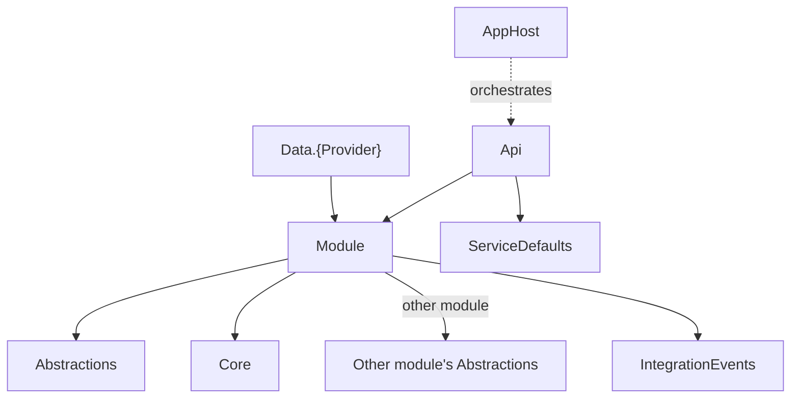

# 05 Building Block View

The one solution structure for a JSdotNet application (ADR 0003): a modular monolith with
feature slices per module. A small app is the same shape with one module. Each block has its
own page under [building-blocks/](building-blocks/); the C4 seed a project starts from is
[workspace.dsl](workspace.dsl).

`Company.Product` is the placeholder; `Contoso.Orders` is the worked example throughout.

## Level 1: the solution

```text
Company.Product/
├── src/
│   ├── App/                                    # the UI, when there is one (ADR 0009)
│   ├── Aspire/
│   │   ├── Company.Product.AppHost/            # building-blocks/apphost.md
│   │   ├── Company.Product.MigrationRunner/    # applies every module's migrations, then exits
│   │   └── Company.Product.ServiceDefaults/    # building-blocks/service-defaults.md
│   ├── Core/
│   │   └── Company.Product.Core/               # ICommandHandler, IQueryHandler, Result<T>
│   ├── Harness/                                # building-blocks/test-harness.md
│   │   └── Company.Product.Harness.{Service}/
│   ├── Shared/
│   │   └── Company.Product.IntegrationEvents/  # cross-module event contracts (ADR 0006)
│   └── {Module}/                               # one folder per module: building-blocks/module.md
│       ├── Company.Product.{Module}/
│       ├── Company.Product.{Module}.Abstractions/
│       ├── Company.Product.{Module}.Api/       # building-blocks/api.md
│       └── Company.Product.{Module}.Data.{Provider}/  # building-blocks/data-provider.md
├── tests/                                      # tests live here only (ADR 0010)
│   ├── Company.Product.{Module}.UnitTests/
│   ├── Company.Product.{Module}.IntegrationTests/
│   ├── Company.Product.ArchitectureTests/
│   └── Company.Product.E2ETests/               # Playwright, when there is a UI
├── Directory.Build.props
├── Directory.Packages.props
├── global.json
└── Company.Product.slnx
```

Worked example, one module:

```text
Contoso.Orders/
├── src/
│   ├── App/
│   ├── Aspire/
│   │   ├── Contoso.Orders.AppHost/
│   │   ├── Contoso.Orders.MigrationRunner/
│   │   └── Contoso.Orders.ServiceDefaults/
│   ├── Core/Contoso.Orders.Core/
│   └── Orders/
│       ├── Contoso.Orders/
│       ├── Contoso.Orders.Abstractions/
│       ├── Contoso.Orders.Api/
│       └── Contoso.Orders.Data.Postgres/
├── tests/
│   ├── Contoso.Orders.UnitTests/
│   ├── Contoso.Orders.IntegrationTests/
│   ├── Contoso.Orders.ArchitectureTests/
│   └── Contoso.Orders.E2ETests/
└── Contoso.Orders.slnx
```

A one-module app whose module carries the product's name keeps the project names short
(`Contoso.Orders`, not `Contoso.Orders.Orders`). A second module adds a folder beside
`Orders/` (for example `Contoso.Orders.Invoicing`).

## Blocks

| Block | Responsibility | Page |
|---|---|---|
| Module | One business capability: its domain, feature slices, data and contract | [module.md](building-blocks/module.md) |
| Domain model | Aggregates, entities and value objects that guard the invariants | [domain-model.md](building-blocks/domain-model.md) |
| Api | The module's HTTP edge: endpoint classes, validation, Problem Details, OpenAPI | [api.md](building-blocks/api.md) |
| `Data.{Provider}` | EF Core persistence, migrations and the outbox for one module | [data-provider.md](building-blocks/data-provider.md) |
| AppHost | The Aspire model of every resource, locally and in Azure | [apphost.md](building-blocks/apphost.md) |
| ServiceDefaults | Telemetry, health checks, service discovery and resilience for every service | [service-defaults.md](building-blocks/service-defaults.md) |
| Test harness | `Fake*` adapters and harness services that stand in for external systems | [test-harness.md](building-blocks/test-harness.md) |
| Notifications | Stored notifications sent and retried by a background worker | [notifications.md](building-blocks/notifications.md) |
| File storage | An `IFileStorage` port with a Blob Storage adapter | [file-storage.md](building-blocks/file-storage.md) |

## Dependency rules



- A module references another module only through its `Abstractions` project or an
  integration event, never its implementation, data project or tables.
- `Abstractions` references nothing of its own module; it holds DTO records and service ports.
- `Data.{Provider}` implements the module's repository ports; the module never references it.
  The Api composes both in its `Program.cs`.
- Domain and Api projects never reference EF Core.
- Architecture tests in `Company.Product.ArchitectureTests` enforce every rule above; each
  production project carries an `AssemblyReference` marker type for them.

## Naming

| Artifact | Pattern | Example |
|---|---|---|
| Project | `{Company}.{Product}[.{Module}][.{Layer}][.{Provider}]` | `Contoso.Orders.Data.Postgres` |
| Module folder | The module name alone | `Orders/` |
| Feature namespace | `{Module}.Features.{Feature}` | `Contoso.Orders.Features.SubmitOrder` |
| Command / query | `{Feature}Command` / `{Feature}Query` | `SubmitOrderCommand` |
| Handler | `{Feature}CommandHandler` / `{Feature}QueryHandler` | `SubmitOrderCommandHandler` |
| DTO | `{Entity}Dto`, `{Feature}Request` in `Abstractions.DataTransferObjects` | `OrderDto` |
| Module registration | `Add{Module}Module` | `AddOrdersModule` |
| Endpoint class | `{Feature}Endpoint` with `Map{Feature}` | `SubmitOrderEndpoint` |
| Test project | `{Project}.UnitTests` / `.IntegrationTests` | `Contoso.Orders.UnitTests` |

`.slnx` is the only solution file; its solution folders mirror `src/` and `tests/`.

## Anti-patterns

- A second, "simple" solution profile, or a module-local test project inside `src/`.
- One data project shared by several modules, or a module reading another module's tables.
- EF Core entities or provider types in `Abstractions`.
- Business logic in an endpoint, handler or data project.
- One `Abstractions` project for the whole solution.
