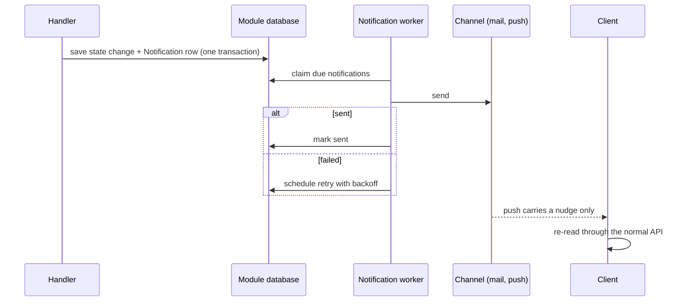

# Building Block: Notifications

How an app tells a user something happened: by email, push or in-app. Part of the
[building-block view](../05-building-block-view.md).

## Shape

## Rules

- A notification is a stored record (recipient, kind, payload reference, status, attempts,
  next attempt), written in the same transaction as the change that caused it.
- A background worker (a hosted service in the module's [Api](api.md)) sends due
  notifications and retries with backoff; after the last attempt the record is marked failed
  and logged.
- Sending is idempotent: the record id is the deduplication key at the channel.
- A push message carries only a nudge (kind and id), never the data; the client re-reads
  through the API under its own authorization (ADR 0008).
- Each channel is a port (`INotificationChannel`) with one adapter per provider; the
  provider is the app's choice, recorded in its own ADR, with a [harness](test-harness.md)
  stand-in for local runs.
- User preferences (which kinds, which channels) live in the module that owns the user.
