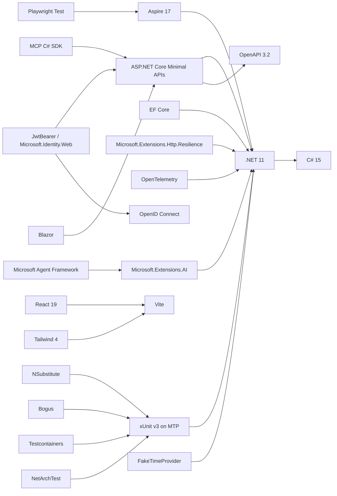

# Technology Graph

The default technology ratings: which technologies every JSdotNet application builds on, and
which it does not start using. Each rating is the outcome of an ADR in
[../arc42/adr/](../arc42/adr/README.md) and of the versions in the golden-setup template's
[Directory.Packages.props](../../aspire/templates/app-defaults/Directory.Packages.props). When
this folder and an ADR disagree, the ADR wins and this folder is corrected.

## Layers

| File | Covers |
|---|---|
| [shared.md](shared.md) | The platform and the contracts every layer uses: .NET, C#, OpenAPI, OpenID Connect, OpenTelemetry |
| [backend.md](backend.md) | The Api host, application layer, persistence, security, MCP and agents |
| [web.md](web.md) | The UI app under `src/App/` |
| [tooling.md](tooling.md) | Orchestration, build and test tooling |

Read this file first, then `shared.md`, then the layer files alphabetically, then
`tooling.md`.

## Ratings

| Rating | Meaning in the defaults |
|---|---|
| `adopted` | The default for its role; a new app uses it without its own ADR. |
| `hold` | Not used in a new app. An existing use is kept until the code around it is touched. |

Candidates and trials are not rated here. A technology an ADR names as "watch" stays in that
ADR until a rewrite of it adopts or holds the technology. The application's own `tech/`
folder rates what it picks on top of these defaults, such as its database provider, broker
and identity provider.

## Graph

Edges read "depends on". The graph draws the adopted technologies; held ones have no edges.

## Extending the graph

- Add a technology as one `## <Technology>` chapter in the layer that owns it, with its
  rating, version where one is pinned, what it depends on, and the ADR behind the rating.
- A technology used by two layers goes in `shared.md`.
- Change the ADR first; this folder records its outcome.
- Add the node and its edges to the graph above in the same change.
- These files carry no devbook `meta` blocks, so the defaults do not depend on devbook's
  schema. A project's `.devbook/tech/` links a chapter here instead of repeating it.
